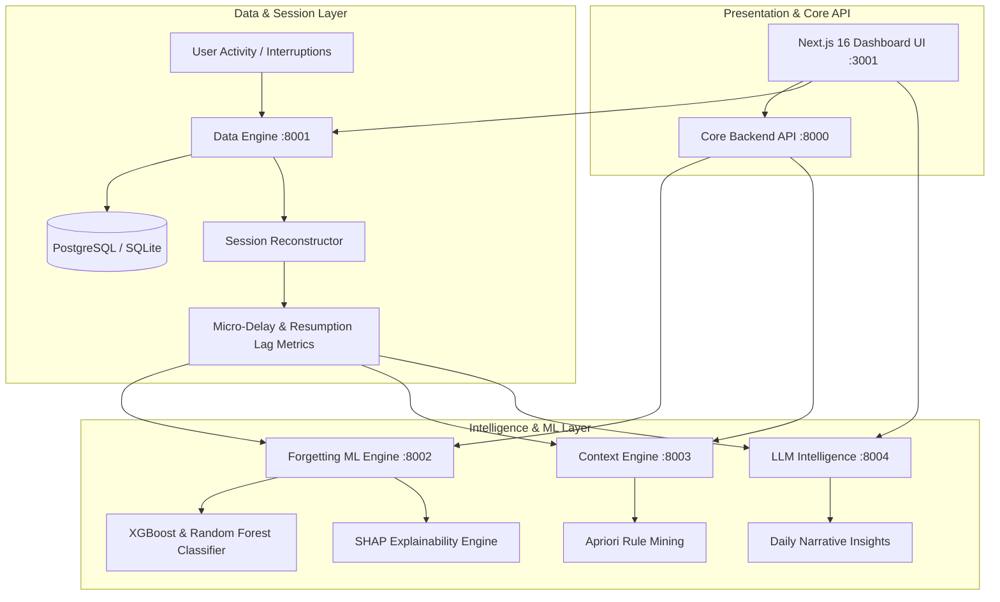

# ContextIQ: Behavioral Intelligence & Micro-Delay Analytics
*An AI-Driven System for Quantifying Cognitive Resumption Lag, Context Loss, and Predictive Task Forgetting*

---

## 1. Executive Summary & Core Innovation

Most productivity apps act as simple digital checklists (*"Did you complete Task X?"*). They treat human attention as a binary on/off switch and fail to address **why** knowledge workers and students abandon work and miss deadlines.

**ContextIQ introduces a behavioral paradigm shift:**
Instead of tracking what you planned to do, ContextIQ continuously observes **how you actually work**:
1. **Micro-Delay Quantifier (Resumption Lag):** Quantifies the invisible latency (seconds/minutes of cognitive recovery) required to regain flow after an interruption or context switch.
2. **Predictive Forgetting Shield:** Evaluates task deadline pressure against observed micro-delays to calculate real-time forgetting probability $P(\text{Forget} \mid \text{Context})$.
3. **Behavioral Friction Index:** A single composite metric ($0 - 100$) combining interruption density, micro-delay overhead, and task switching penalties.
4. **Contextual Task Association ("One More Thing"):** Uses association rule mining to discover location- and environment-correlated tasks before you leave.

---

## 2. System Architecture



---

## 3. The 3 Technical Pillars for Your Project Viva / Resume

### Pillar 1: Workflow Reconstruction & Micro-Delay Detection (Data Science)
- **Problem:** Real-world workflows are fragmented. A user doesn't log *"I was interrupted for 4 minutes and took 6 minutes to resume."*
- **Solution:** The Data Engine ingests raw event streams (`task_start`, `task_pause`, `interruption_event`, `task_resume`) and reconstructs cohesive `ContextSession` records.
- **Key Metric:** `resume_delay_seconds`—the latency between the end of an external disruption and the first active keystroke/event on the primary task.

### Pillar 2: Interpretable Forgetting Probability (Machine Learning)
- **Problem:** Black-box ML models are frustrating for users (*"Why does the app say I will forget this?"*).
- **Solution:** An interpretable pipeline that feeds deadline slack, historical completion frequency, and current micro-delay density into an ensemble classifier.
- **Explainability:** Integrated with **SHAP** (Shapley Additive Explanations) so the system explains:
  > *"Predicted forgetting probability: 82%. Primary driver: 3 consecutive micro-delays experienced in your Study category today."*

### Pillar 3: Contextual Discovery via Association Rules (Recommender Systems)
- **Problem:** People remember high-priority tasks, but forget incidental tasks associated with physical places (e.g., leaving the lab without getting a professor's signature).
- **Solution:** Frequent itemset mining ($Support \ge 0.15$, $Confidence \ge 0.60$) that clusters location coordinates and categories to trigger proactive alerts.

---

## 4. How to Run and Demo the Project

### Fast Start (1-Click)
Open PowerShell in `contextiq-complete` and run:
```powershell
.\start_windows.ps1
```

### Active Endpoints
- **Frontend Dashboard:** [http://localhost:3001](http://localhost:3001)
- **Core Backend Docs:** [http://localhost:8000/docs](http://localhost:8000/docs)
- **Data Engine Docs:** [http://localhost:8001/docs](http://localhost:8001/docs)
- **Forgetting ML Docs:** [http://localhost:8002/docs](http://localhost:8002/docs)
- **Context Engine Docs:** [http://localhost:8003/docs](http://localhost:8003/docs)
- **Intelligence Docs:** [http://localhost:8004/docs](http://localhost:8004/docs)

*(Tip: In `frontend/.env.local`, switching `NEXT_PUBLIC_USE_MOCK=true` enables an instant offline demonstration mode with full synthetic micro-delay simulations).*
